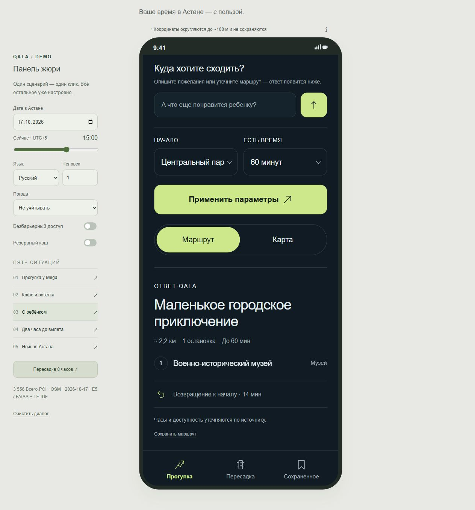

# QALA — ваш час в Астане

Рабочий RAG-прототип для хакатона НИЦ Smart City: 1–3 места поблизости, объяснение выбора и маршрут с возвращением в пределах времени. Учитывает часы работы, ребёнка, доступность, группу, погоду и пересадку между рейсами.

Основной сайт — **FastAPI + HTML/CSS/JavaScript**, без сборки фронтенда. Поле запроса находится **вверху внутри сайта**. Ниже — параметры, маршрут или карта; разделы «Прогулка», «Пересадка», «Сохранённое». Интерфейс и ответы доступны на ru/en/kk.



## Запуск с нуля

Нужен 64-битный Python **3.11 или 3.12**; проверено на Windows с Python 3.12. Ключ API для локального демо не нужен. Node.js и GNU Make необязательны.

```powershell
git clone https://github.com/torch883/qala-astana-walk.git
cd qala-astana-walk
python -m venv .venv
.\.venv\Scripts\python.exe -m pip install -r requirements.txt
.\.venv\Scripts\python.exe -m data.download_model
powershell -ExecutionPolicy Bypass -File .\Start-Demo.ps1
```

Откройте **http://127.0.0.1:8000**. После установки запуск на Windows — последняя команда. Скрипт выбирает `.venv` проекта или Python из `PATH`; другой интерпретатор можно указать через `-Python`, порт — через `-Port`. Привязки к папкам автора нет.

На macOS/Linux после клонирования:

```bash
python3 -m venv .venv
source .venv/bin/activate
python -m pip install -r requirements.txt
python -m data.download_model
make run
# Без make:
python -m uvicorn api:app --host 127.0.0.1 --port 8000 --no-access-log
```

Снимок OSM, Parquet, FAISS-индекс, Leaflet и схема улиц входят в репозиторий. Веса E5 скачиваются один раз; при отсутствии весов или несовпадении индекса работает **явно подписанный TF-IDF fallback**. На первом старте модель загружается в память до готовности API. Дальше локальное демо работает без сети. `requirements.lock.txt` — снимок проверенного Windows-окружения; для установки на другой ОС используйте `requirements.txt`.

Проверка готовности: [GET /api/health](http://127.0.0.1:8000/api/health). Ожидается `ready: true`, `poi_count: 3556`, `retrieval_backend: "e5+lexical"`. Swagger: [http://127.0.0.1:8000/docs](http://127.0.0.1:8000/docs).

Для точного повторения проверенного Windows-окружения можно установить `python -m pip install -r requirements.lock.txt`: все 76 закреплённых версий совпадают с окружением последнего прогона.

## Показ за 3–4 минуты

Панель жюри слева; на телефоне раскройте её вверху. Кнопки задают публичные места и фиксированное время Астаны (UTC+5).

1. **Прогулка у Mega** — маршрут на 30–60 минут, включая возвращение; переключите «Карта».
2. **Кофе и розетка** — раскройте карточку → «Уточнения и данные»: розетка и тишина честно отмечены `unknown`.
3. **С ребёнком** — подходящая категория без обещаний непроверенных интерактивов.
4. **Два часа до вылета** — отказ от выхода в город из-за времени дороги и резерва.
5. **Ночная Астана** — в 23:30 проверяется весь визит; смените время на 00:30 и примените параметры.
6. **Пересадка 8 часов** — три остановки, время возвращения к точке высадки, трансфер и резерв перед рейсом.

Кнопка **«i / Как это получилось»** показывает ограничения, кандидатов, оценки, причины отсева и фактический режим генерации. Вводите новые пожелания в верхнем поле; последние шесть реплик учитываются только в памяти страницы. После изменения параметров нажмите «Применить параметры». На мобильном ответ автоматически попадает в видимую область.

До первого расчёта показан подписанный пример оформления. Реальный ответ может содержать меньше трёх остановок или отказ. В «Сохранённом» остаются только названия, категории и ссылки на публичные POI; старые часы, путь, личные пожелания и точка старта не сохраняются.

## Проверенное качество · 19 октября 2026

| Проверка | Результат |
|---|---|
| Python: модули, API, Streamlit, защита, погода, пересадка | **113/113** |
| JavaScript: приватность и восстановление закладок | **5/5** |
| Eval: заданные сценарии и крайние случаи | **33/33** |
| Работающий HTTP API: публичные сценарии | **12/12** |
| ID за пределами базы | **0 из 45** рекомендаций eval |
| Заданные ограничения / метки источников | **100% / 100%** |
| POI / категории и теги / часы работы | **3 556 / 100% / 39,9%** |
| Движок: p50 / p95 / запуск | **16,4 / 444,1 мс / 1,33 с** |
| Пять основных сценариев через HTTP | **32,5–160,8 мс** |

Это локальные замеры прогретого движка с E5 и шаблонами, без внешнего LLM и погодного API, не нагрузочный тест. «0 выдуманных ID» не означает актуальность всех сведений OSM. Подробности: [eval/report.md](eval/report.md), [HTTP-проверка](eval/api_smoke.json), [полная проверка](docs/verification.md), [сценарии и ограничения](docs/test_scenarios.md).

## Погода, пересадка и режимы

**Погода.** По умолчанию отключена. Можно выбрать живой Open-Meteo или подписанный демо-сценарий мороза, метели, дождя, жары. В суровую погоду остаются помещения и короткие отрезки по улице; возможен тёплый путь через OSM-контур ТРЦ. В погодный сервис уходит только фиксированный центр Астаны и дата. При ошибке прогноз не учитывается, интерфейс сообщает об этом. Реальный прогноз проверен; данные для демонстрационных дат могут быть недоступны.

**Пересадка.** Расчёт назад от вылета: выход из аэропорта, дорога в город, прогулка, обратное такси и минимум 120 минут резерва. Такси — оценка с запасом на пробки, не данные навигационного сервиса. На экране указан крайний срок возвращения к точке высадки в городе. Если времени мало, маршрут не выдаётся. Визы, багаж и задержки рейса не проверяются. Пороги и веса: `config.yaml`.

**LLM.** Скопируйте `.env.example` в `.env`. Для Gemini задайте `LLM_PROVIDER=gemini`, `GEMINI_API_KEY` и доступную вашему проекту модель в `GEMINI_MODEL`. Без ключа работают локальные правила и шаблоны; живой Gemini в этой проверке не участвовал. Локальный поиск E5 при этом остаётся семантическим. `LLM_TIMEOUT_SEC` ограничивает отдельный вызов, а не весь запрос с повторами.

**Кэш.** `DEMO_CACHE=1` включает начальное состояние переключателя. На диске только пять публичных сценариев; при точном совпадении перепроверяются часы и ограничения. Погода и явный дедлайн пересчитываются. Произвольные запросы на диск не пишутся. Кэш требует работающего API; при полном отказе сервера новый маршрут не рассчитывается.

**Приватность.** Координаты округляются до сетки около 111 × 140 м. Нет аккаунтов, аналитики и постоянной истории запросов; HTTP access log отключён. Карта локальная. Явно сохранённые POI остаются в localStorage этого браузера. Подробнее: [docs/ethics_privacy.md](docs/ethics_privacy.md).

## Проверки и обновление данных

Команды выполняются из корня проекта в активированном окружении (Windows: `.\.venv\Scripts\Activate.ps1`; Linux/macOS: `source .venv/bin/activate`). Вместо `python` можно указать полный путь к интерпретатору.

```bash
python -m pytest -q
python -m eval.run_eval
# При работающем сайте:
python -m eval.smoke_api
# Необязательный Node.js 20+ для проверки закладок:
node --test tests/test_frontend.mjs
```

Отчёты: `eval/report.md`, `eval/results.json`, `eval/api_smoke.json`. Фикстуры с изменёнными часами и инъекцией существуют только в памяти тестов. В `eval/answers.json` — ответы на заранее заданные публичные кейсы.

```bash
python -m data.collect --refresh
python -m data.collect_warm --refresh
python -m data.enrich --templates
python -m core.retrieve --build
python -m eval.build_cache
python -m eval.run_eval
```

Сбор автоматизирован через Overpass. Без `--refresh` используются сохранённые исходные ответы; при ошибке сети сборщик не подменяет POI выдумками. Обновление лучше делать заранее: изменившийся снимок может изменить ответы демо. `gold_review.yaml` сохраняет редакторские решения. Для LLM-обогащения уберите `--templates`; например, `--limit 50` ограничивает объём обработки. Обогащение хранится отдельно с `generated=true`. После обновления нужны индекс и новый публичный кэш. `MODEL_CACHE_DIR` задаёт другой путь к весам модели.

## Структура и ограничения

- `api.py`, `ui_service.py`, `web/` — основной сайт, API и адаптер представления.
- `core/` — разбор, гео, расписание, гибридный поиск, ранжирование, генерация, валидатор, погода и маршруты.
- `data/` — сбор, исходные ответы, снимок, FAISS, отчёт качества и редакторские пометки.
- `tests/`, `eval/` — проверки и воспроизводимые отчёты.
- `docs/` — [архитектура RAG](docs/rag.md), [интерфейс/API](docs/frontend.md), [10 слайдов](docs/presentation.md), [сценарий показа](docs/demo_script.md).
- `app.py` — прежний Streamlit-интерфейс, доступный через `make legacy`; для основного показа не нужен.

OSM-снимок собран 17.10.2026. 50 объектов проверены ассистентом по исходным тегам, без звонков и выездного аудита человеком. 472 безымянные площадки и парка подписаны как «без названия в OSM»; это реальные объекты, но не официальные названия. Рейтингов посетителей нет. Розетки, тишина и интерактивы обычно неизвестны. Путь — прямая × 1,3, не навигация по входам и переходам; `wheelchair=yes` не гарантирует доступность всего пути. Тёплые маршруты не проверяют входы и проход сквозь здания. Реальные события и расписания транспорта не подключены. Казахский требует вычитки носителем, фильтр вредных запросов на правилах имеет ограничения. Прототип подготовлен для локального показа, не для публичного сервиса под нагрузкой.

## Источники и лицензии

Данные: © [OpenStreetMap contributors, ODbL](https://www.openstreetmap.org/copyright), [Overpass](https://dev.overpass-api.de/overpass-doc/en/). Модель: [multilingual-e5-small](https://huggingface.co/intfloat/multilingual-e5-small), MIT. Погода: [Open-Meteo](https://open-meteo.com/), CC BY 4.0; условия использования сервиса проверяйте перед коммерческим запуском. Лицензия Leaflet лежит в [web/vendor/LICENSE](web/vendor/LICENSE). Код — [MIT](LICENSE).
