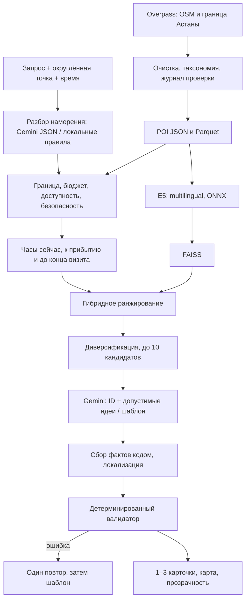

# Как работает RAG

**Получение данных.** `data.collect` запрашивает административную границу relation/3087155, POI и исторические достопримечательности. Объекты вне полигона, без имён и дубли удаляются. `gold_review.yaml` хранит воспроизводимые редакторские решения; оригинальные теги остаются в `raw/` и `tags`. Отдельное `enrichment` всегда имеет `generated=true` и метод генерации. При отсутствии ключа это `category_template`, а не LLM.

**Контекст до поиска.** Координаты округляются до сетки порядка 100 м. Haversine даёт расстояние по прямой; путь пешком — расстояние × 1,3 / 80. Учитывается обратный путь. Транспорт — грубая оценка 350 м/мин + 8 минут, без расписаний и пробок. Время — Asia/Almaty. `opening-hours-py` вычисляет расписание; неподтверждённый календарь PH/SH оставляет статус unknown. Закрытые, закрывающиеся до конца визита, недоступные по жёстким требованиям места исключаются. Ночью нужны подтверждённые часы; для открытых пространств также освещение.

**Поиск и ранжирование.** Локальная `intfloat/multilingual-e5-small` использует `query:`/`passage:`, нормализованные векторы и FAISS IndexFlatIP. Семантика смешивается с символьным TF-IDF. Далее добавляются близость, соответствие категории, часы и проверка источника; неизвестные часы штрафуются. Рейтинги отсутствуют, поэтому бонус популярности равен нулю. Веса лежат в `config.yaml`. В выдаче максимум два места одной категории. При недоступной модели UI явно показывает лексический fallback.

**Генерация без произвольных фактов.** Gemini получает только 10 отобранных кандидатов, их допустимые коды объяснения/занятия и бюджет. Он выбирает ID и идею; код подставляет проверенные факты и тексты ru/en/kk. Это намеренное ограничение выразительности ради проверяемости: свободный LLM-текст нельзя надёжно проверить на выдуманные услуги. Длительность и занятие имеют `generated_idea`, факты — `poi_data`, вычисления — `calculated`. Схема расширяет заданный формат полями `travel_min`, `idea_source`, `source_url`, `field_sources` и `alternative`.

**Валидация.** Код проверяет ID, уникальность, 1–3 рекомендации, расстояние, время, часы, бюджет и источники. Ошибочный ответ вызывает один повтор, затем локальный шаблон. Если кандидатов нет, список пуст; ближайшая допустимая альтернатива вынесена отдельно с конкретным ослаблением ограничения. Правила безопасности и wheelchair не ослабляются. За два часа до вылета действует отказ от прогулки с резервом на аэропорт. Это консервативная настройка прототипа, а не требование авиакомпании.

**Источники реализации.** [Overpass — запросы по области](https://dev.overpass-api.de/overpass-doc/en/full_data/area.html), [Gemini generateContent](https://ai.google.dev/api/generate-content), [opening-hours-py](https://pypi.org/project/opening_hours_py/), [модель E5](https://huggingface.co/intfloat/multilingual-e5-small), [FastEmbed](https://github.com/qdrant/fastembed).
